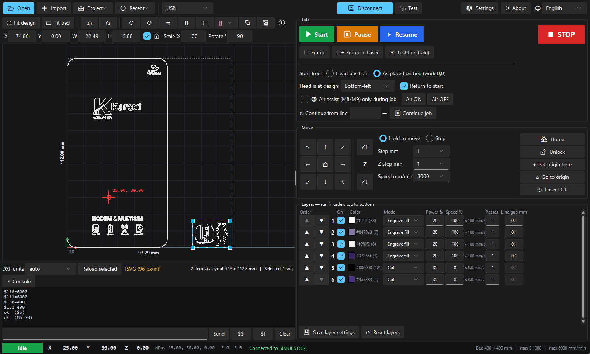
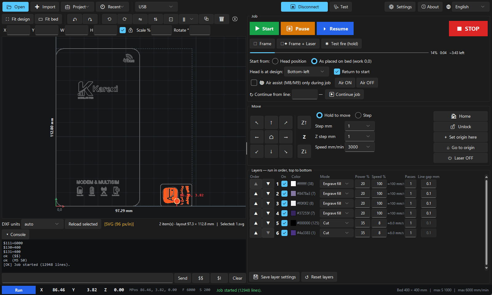
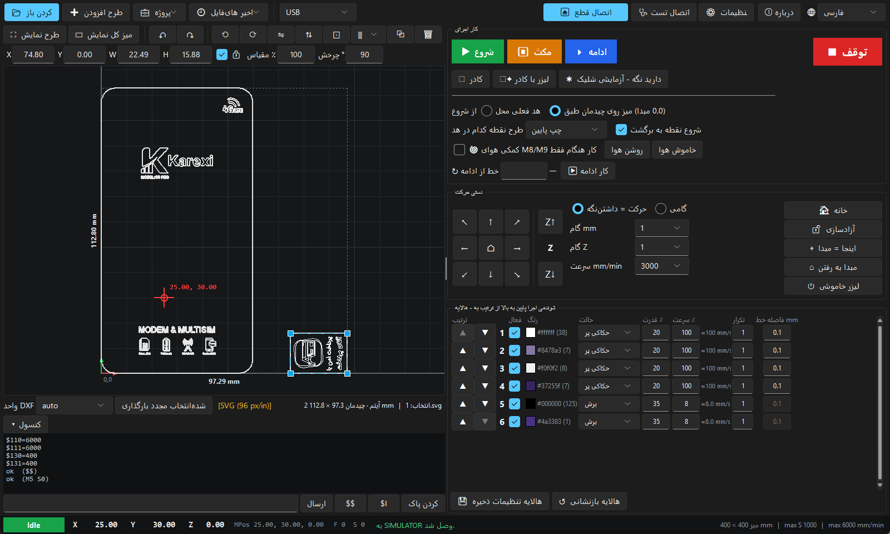

# Karexi CAD

**Free GRBL laser engraver / cutter control software: DXF/SVG import, layout, cut & engrave, USB and Wi-Fi.**

Karexi CAD is a simple Windows app for diode/CO₂ laser machines running **GRBL** (GRBL 1.1, Grbl_Esp32, FluidNC-style controllers such as MKS DLC32). Open a DXF or SVG from CorelDRAW, Illustrator, Inkscape or any CAD program, choose what each colour does (cut or engrave), arrange the designs on the bed, and press **Start**.

by **karexi.org – M. Amini** · [karexi.org](https://karexi.org) · [فارسی ↓](#فارسی)

## Features
- **Files:** DXF (CorelDRAW inch/mm units detected automatically), SVG (fills and strokes, transforms), G-code (`.gc .nc .gcode .ngc .tap`).
- **Layers by colour:** each colour is one layer – *Cut*, *Engrave fill* (scan-line hatch), *Engrave line* or *Skip*,
  with **Power %** and **Speed %** (the mm/s value is shown), passes, and a run order you can change (▲ ▼).
  Move a whole design, or one colour group of it, to another or a new layer; change layer colours.
- **Layout editor:** several designs on one bed – drag, resize with locked aspect, rotate any angle, mirror, align,
  center, duplicate, delete, undo/redo; exact X / Y / W / H fields; zoom & pan.
- **Live preview:** the head position (red cross) and the burned path drawn in real time; bed size read from the controller.
- **Jog:** hold-to-move (stops the moment you release) or step mode; keyboard arrows; Z jog; set origin; home; unlock.
- **Frame** (laser off) or **Frame + Laser** (low-power glow so you see the outline on the material), test fire.
- **Projects** (`.kxc`): designs embedded, positions, layer settings, connection, and the progress of an interrupted job.
  Old LaserSender `.lsp` projects still open.
- **Continue an interrupted job** from the line it stopped at (laser-off travel, modal state restored).
- **USB** (serial) or **Wi-Fi / LAN** (raw TCP, e.g. port 8080 on MKS DLC32 / Grbl_Esp32, 23 telnet) with
  **network scan** that finds the machine even when its IP address changes.
- **Air assist** M8/M9 automatically at job start/end (optional), dark UI, **English / فارسی** interface,
  no pop-up dialogs while working.
- Built-in **simulator** port to practise without a machine.

| Job / layers panel | Persian UI |
|---|---|
|  |  |

## Download
**Windows:** download `KarexiCAD.exe` from the
[latest release](https://github.com/doradrme/karexi-cad/releases/latest) and run it – no installation needed.
Put it in its own folder (it keeps `settings.json` next to the exe). Windows SmartScreen may warn about an unsigned
app: *More info → Run anyway*.

## Quick start
1. Close LightBurn / LaserGRBL – only one program can use the USB port.
2. Start Karexi CAD. Choose **USB** (the serial port is auto-selected, 115200 baud) or **Wi-Fi / LAN** → **Connect**.
   Opening USB restarts most boards – wait a few seconds.
3. **Open** a DXF / SVG / G-code file. **Import** adds more designs to the same bed.
4. In the **Layers** panel choose the mode, power %, speed % and order of each colour.
5. Jog the head to the start point (or use *As placed on bed* with a work origin), then **Frame** to check the position.
6. Focus the laser, put on your goggles, press **Start**. **Pause / Resume / STOP** (Esc = STOP).

## Wi-Fi / network connection
- Join the controller to the same Wi-Fi as the PC (see your board's web page). Choose **Wi-Fi / LAN**, enter the host
  and port (MKS DLC32 / Grbl_Esp32 raw GRBL port is usually **8080**; telnet is **23**) and press **Connect**.
- **📡 Scan** searches your local network (every /24 subnet of the PC's network adapters, plus `*.local` names such as
  `grblesp.local`) on the ports listed in *Settings → Network* (default `8080, 23`) and lists every GRBL controller
  with its firmware version. Pick one and press *Use & connect*; it is remembered.
- If the machine does not answer at the saved address (for example the router gave it a new IP), Karexi CAD scans
  automatically and connects if exactly one controller is found.
- Scanning and **Test** are **read-only**: they only send the status query `?` and the build-info query `$I`.
  Nothing moves and the laser is never switched on.
- For long jobs USB is usually more reliable than Wi-Fi.

## GRBL notes
- Enable **laser mode**: `$32=1`. Set `$30` to your spindle max (e.g. `1000`) and enter the same value as *Max S* in Settings.
- Karexi CAD always uses **`M3` constant power** with `S` on every move; it never sends `M4` (some boards reject it
  with `error:20`). Every job ends with `M5 S0`.
- Speeds are percentages of *Max speed* (mm/min, read from `$110` when connected). Bed size is read from `$130/$131`.
- Convert texts to curves in your design program. CorelDRAW DXF files are usually in inches – detected automatically;
  override with *DXF units* if the size looks wrong.

## Supported files
| Type | Extensions | Notes |
|---|---|---|
| DXF | `.dxf` | lines, polylines, arcs, circles, ellipses, splines, blocks; `$INSUNITS` honoured |
| SVG | `.svg` | paths, shapes, fills & strokes, transforms (96 px/in) |
| G-code | `.gc .nc .gcode .ngc .tap` | streamed as-is (cleaned: `M4`→`M3`) |
| Project | `.kxc` (and old `.lsp`) | JSON with embedded designs |

## ⚠ Safety
Lasers can blind you instantly and start fires. **Always wear certified goggles for your laser's wavelength**, never
leave a running machine unattended, use ventilation/fume extraction, keep a fire extinguisher nearby, and never cut
PVC/vinyl (toxic chlorine gas). Use this software at your own risk – see the license.

## License
Free to use and share the unmodified program. See [LICENSE.txt](LICENSE.txt).
All rights reserved. Copyright © 2026 **karexi.org – M. Amini**.

---

## فارسی

**کارکسی کد (Karexi CAD)** نرم‌افزار رایگان کنترل دستگاه‌های حکاکی و برش لیزری **GRBL** است، ساخت **karexi.org – م. امینی**.

### امکانات
- باز کردن فایل‌های **DXF** (واحد اینچ کورل خودکار تشخیص داده می‌شود)، **SVG** و **G-code**.
- هر رنگ یک لایه: **برش**، **حکاکی پر**، **حکاکی خطی** یا **رد کردن**، با **درصد قدرت** و **درصد سرعت** و ترتیب اجرا (▲ ▼).
- ویرایشگر چیدمان: چند طرح روی یک میز، جابه‌جایی، تغییر اندازه، چرخش، قرینه، تراز، تکثیر، برگشت (Undo).
- پیش‌نمایش زنده مسیر سوخته و موقعیت هد، حرکت دستی با نگه داشتن دکمه، **قاب** با لیزر خاموش یا روشن کم‌نور.
- ذخیره پروژه (`.kxc`) و **ادامه کار نیمه‌تمام** از همان خط.
- اتصال **USB** یا **Wi-Fi / شبکه** و دکمه **📡 جستجو** که دستگاه را در شبکه پیدا می‌کند؛ اگر IP دستگاه عوض شود، برنامه خودکار جستجو و وصل می‌شود.
- هوای کمکی M8/M9، رابط تیره، **فارسی و انگلیسی**.

### دانلود
فایل `KarexiCAD.exe` را از بخش [Releases](https://github.com/doradrme/karexi-cad/releases/latest) دانلود و اجرا کنید (نیاز به نصب ندارد). اگر ویندوز هشدار SmartScreen داد: *More info → Run anyway*.

### شروع سریع
۱. LightBurn / LaserGRBL را ببندید. ۲. **USB** یا **Wi-Fi** را انتخاب و **اتصال** را بزنید (برای Wi-Fi اگر آدرس را نمی‌دانید **📡 جستجو**).
۳. فایل را **باز** کنید و برای هر رنگ حالت، قدرت و سرعت را تعیین کنید. ۴. هد را به نقطه شروع ببرید و **قاب** بزنید.
۵. فوکوس کنید، عینک بزنید و **شروع** را بزنید. (Esc = توقف اضطراری)

### نکات GRBL
حالت لیزر را با `$32=1` فعال کنید و `$30` را با *حداکثر S* تنظیمات برنامه یکی کنید. برنامه همیشه از `M3` (قدرت ثابت) استفاده می‌کند و هر کار با `M5 S0` تمام می‌شود.
جستجوی شبکه و دکمه تست **فقط خواندنی** هستند (فقط `?` و `$I`)؛ دستگاه حرکت نمی‌کند و لیزر روشن نمی‌شود.

### ⚠ ایمنی
همیشه **عینک استاندارد مخصوص طول موج لیزر** بزنید، دستگاه در حال کار را تنها نگذارید، تهویه داشته باشید، کپسول آتش‌نشانی نزدیک باشد و هرگز PVC نبرید.

### مجوز
استفاده و اشتراک‌گذاری برنامه به‌صورت تغییر‌نیافته آزاد است. جزئیات در [LICENSE.txt](LICENSE.txt).
تمام حقوق محفوظ است. © ۲۰۲۶ karexi.org – م. امینی

